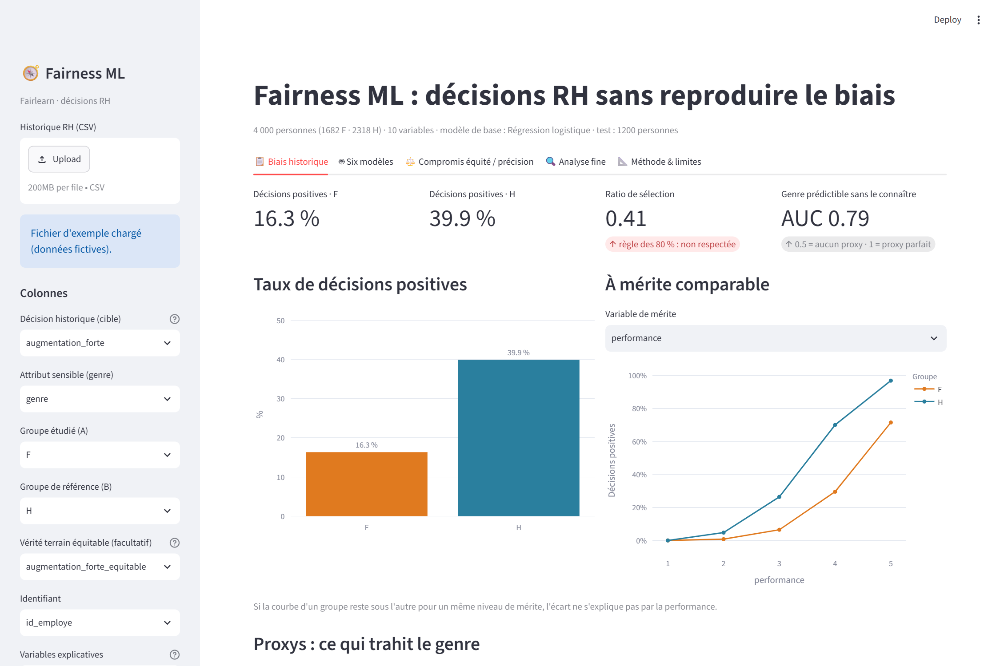
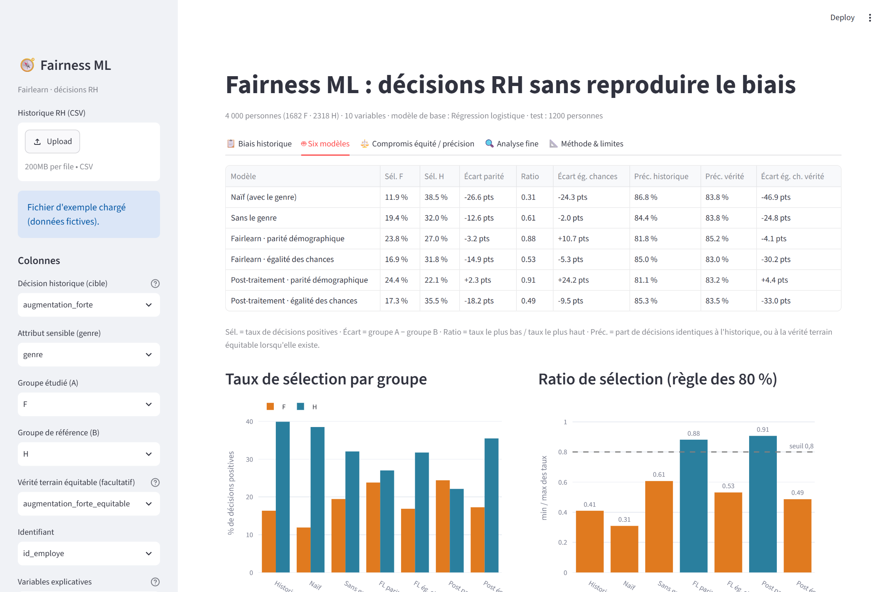
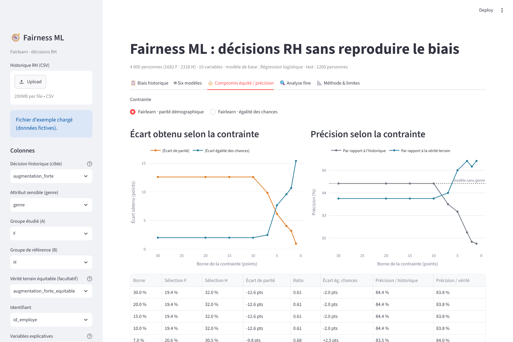
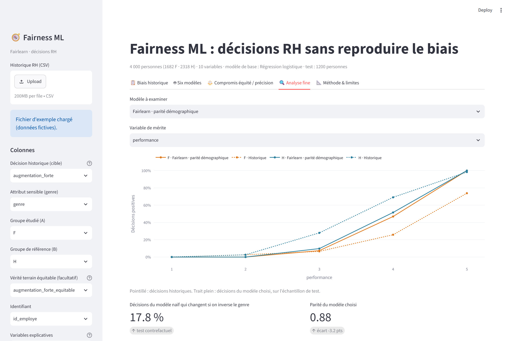

# Fairness ML : des décisions RH qui ne reproduisent pas le biais

Si l'historique des décisions est biaisé (par exemple, les hommes ont toujours été augmentés plus souvent), un modèle
classique apprend ce biais et le reproduit, **même sans voir le genre**. Cette application Streamlit mesure le problème
et le corrige avec les algorithmes de [Fairlearn](https://fairlearn.org) (Microsoft) : contraintes de **parité
démographique** et d'**égalité des chances**.

## Aperçu

**Biais historique** : taux de décisions par groupe, courbes à mérite comparable, audit des proxys du genre



**Six modèles** : du modèle naïf aux algorithmes Fairlearn, avec règle des 80 %



**Compromis équité / précision** : ce que coûte (ou rapporte) une contrainte plus stricte



**Analyse fine** : décisions du modèle à mérite comparable, test contrefactuel, export des décisions



[Méthode et limites](docs/screenshots/5_methode.png)

## Lancer

```bash
pip install -r requirements.txt
python generate_data.py      # régénère data/employes_exemple.csv (optionnel)
streamlit run app.py
```

## Les six modèles comparés

| Modèle | Principe |
| --- | --- |
| Naïf | utilise le genre comme variable : reproduit, voire amplifie, le biais |
| Sans le genre | « équité par ignorance » : le biais passe par les variables corrélées (proxys) |
| Fairlearn · parité démographique | `ExponentiatedGradient` : taux de décisions positives égaux entre groupes |
| Fairlearn · égalité des chances | `ExponentiatedGradient` : taux de vrais positifs égaux entre groupes |
| Post-traitement · parité démographique | `ThresholdOptimizer` : un seuil par groupe |
| Post-traitement · égalité des chances | `ThresholdOptimizer` : un seuil par groupe |

Les métriques affichées : taux de sélection par groupe, écart de parité, **ratio de sélection (règle des 80 %)**, écart
d'égalité des chances, précision par rapport à l'historique et, si elle existe, **par rapport à une vérité terrain
équitable**.

## Ce que montre l'exemple

Sur les données synthétiques (4 000 salariés, biais direct et biais indirect via le temps partiel et les interruptions
de carrière) :

- l'historique donne 16 % d'augmentations fortes aux femmes contre 40 % aux hommes (ratio 0,41) ;
- le modèle naïf creuse l'écart (ratio 0,31), et 18 % de ses décisions changent si l'on inverse uniquement le genre ;
- retirer le genre ne suffit pas (ratio 0,61) : le genre reste prédictible à 79 % (AUC) à partir des autres variables ;
- la parité démographique ramène le ratio à 0,88, et le modèle est **plus proche de la décision équitable** (85,2 %
  contre 83,8 %), alors qu'il paraît moins précis face à l'historique biaisé ;
- l'égalité des chances **ne corrige pas** le biais (ratio 0,53) : elle se mesure par rapport aux décisions passées,
  donc elle préserve un historique biaisé.

## Utiliser vos données

Importez un CSV, puis choisissez : la décision historique (colonne 0/1, ou numérique avec un seuil), l'attribut sensible,
les groupes comparés et les variables explicatives. Une colonne de « vérité terrain équitable » est facultative : elle
n'existe que dans des données synthétiques.

## Tests

```bash
pip install -r requirements-dev.txt
pytest
```

Les tests vérifient les métriques sur un cas calculé à la main, la détection des proxys, et le scénario complet : le modèle
naïf est biaisé, retirer le genre ne suffit pas, la parité démographique corrige, l'égalité des chances préserve un
historique biaisé, le test contrefactuel, et l'effet d'une contrainte plus stricte.

## Limites

- **L'égalité des chances suppose que les étiquettes sont justes** : avec un historique biaisé, préférez la parité
  démographique, qui impose toutefois l'égalité des taux quel que soit le mérite.
- La précision mesurée sur l'historique **pénalise** un modèle équitable, puisque l'historique est biaisé.
- `ThresholdOptimizer` exige de connaître le genre **au moment de la décision**, ce qui peut poser un problème juridique de
  traitement différencié. `ExponentiatedGradient` ne l'utilise qu'à l'entraînement.
- Ces critères sont des statistiques de **groupe** : ils ne garantissent pas l'équité de chaque décision.
- Le choix d'un critère d'équité est **normatif** : à décider avec vos équipes RH et juridiques. Le modèle assiste une
  décision humaine, il ne la remplace pas.
- Fairlearn est utilisé pour la classification. Pour un salaire continu, il faudrait le binariser ou utiliser les contraintes
  de perte bornée par groupe (`BoundedGroupLoss`).
- AIF360 (IBM) propose des algorithmes comparables ; il n'est pas inclus ici.
